# Fairfax County City Environment Explorer

## Software Design Description

| Field | Value |
| --- | --- |
| Document version | 1.0.0 |
| Date | October 27, 2026 |
| Document ID | CEE-SDD-001 |
| Implements | CEE-SRS-001 ([InsightMiner_SRS_v1.0.0.md](./InsightMiner_SRS_v1.0.0.md)) |
| Status | Describes the implementation merged to `main` (PR #1) |

## 1. Introduction

This document describes how the City Environment Explorer (CEE) satisfies the
requirements in the SRS. It covers the system context, runtime structure, data
flow, AI grounding design, deployment, security, and the design decisions behind
them. Requirement identifiers (CEE-FR-xxx, CEE-NFR-xxx) refer to the SRS.

### 1.1 Design goals

1. **Grounded, honest AI.** Summaries cite only evidence supplied with the request.
2. **Real data, resilient delivery.** Use slow public data without blocking users.
3. **Zero stored secrets for Azure access.** OIDC for CI/CD, managed identity at runtime.
4. **Low cost, simple operations.** One container, in-process cache, and a serverless Cosmos DB history store.
5. **Replaceable parts.** Data source, AI model and hosting are isolated behind small modules.

## 2. System context

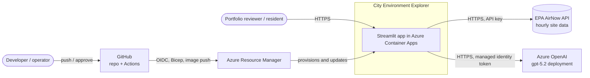

## 3. Architecture overview

### 3.1 Logical components

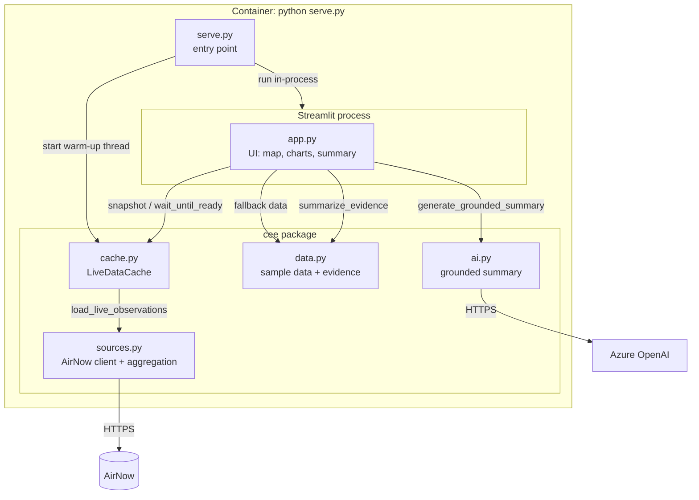

| Module | Responsibility | Key requirements |
| --- | --- | --- |
| [serve.py](../serve.py) | Starts the cache warm-up, then runs Streamlit on `PORT` (default 8501) | CEE-FR-016 |
| [app.py](../app.py) | UI, location selection, charts, labeling of live vs sample data, summary rendering | FR-001 to FR-013, FR-015 |
| [cee/sources.py](../cee/sources.py) | AirNow HTTP client, parsing, hourly to daily aggregation | FR-014, FR-017 |
| [cee/cache.py](../cee/cache.py) | Background load and hourly refresh; keeps last good snapshot | FR-015, FR-016, NFR-009 |
| [cee/data.py](../cee/data.py) | Sample data, evidence building, deterministic fallback summary | FR-010, FR-012, FR-015 |
| [cee/ai.py](../cee/ai.py) | Azure OpenAI call, prompt, citation validation | FR-009 to FR-013 |

### 3.2 Class view

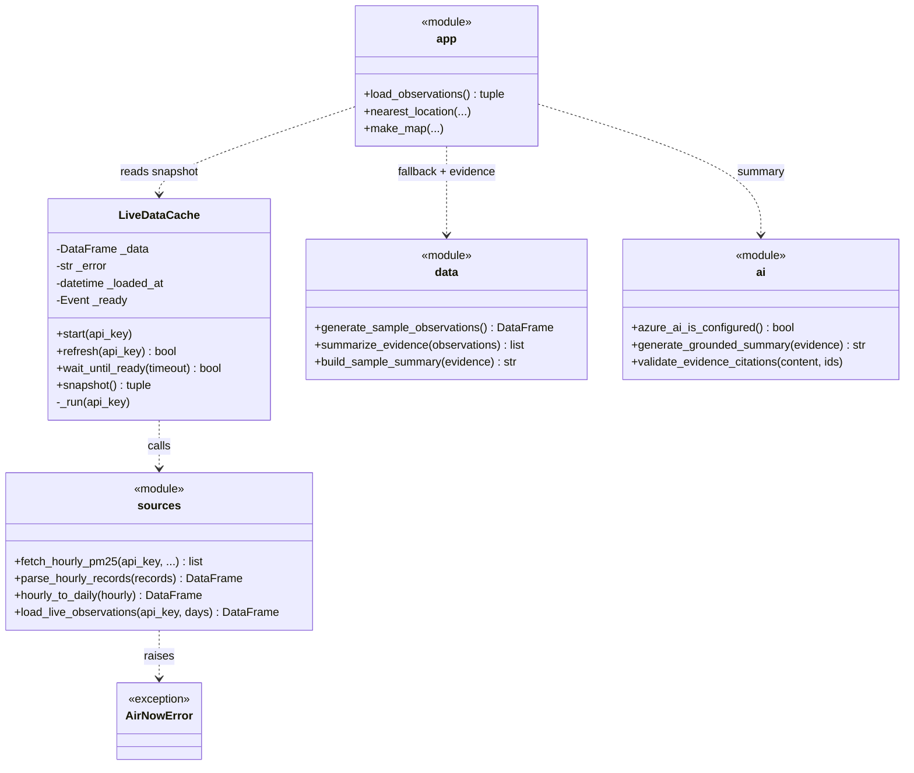

## 4. Data design

### 4.1 Observation model

Daily observations are a pandas DataFrame derived from hourly AirNow records.

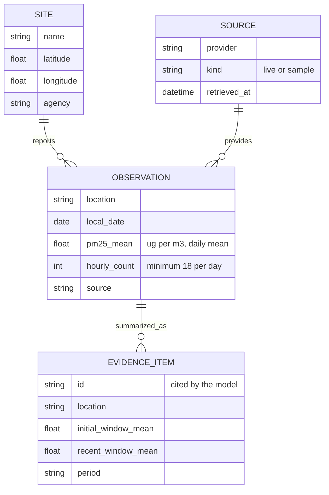

### 4.2 Aggregation rules

- Negative values are AirNow missing-data sentinels and are dropped.
- Hours are grouped into **America/New_York** local days.
- A day with fewer than **18** hourly readings is discarded so that partial days cannot skew trends.
- Evidence values are rounded to one decimal place before they reach the model.
- Missing data stays missing; nothing is interpolated (CEE-NFR-009).

### 4.3 Data source facts

| Item | Value |
| --- | --- |
| Endpoint | AirNow `/aq/data/` (monitoring-site data by bounding box) |
| Parameters | `BBOX` (Fairfax), `dataType=C`, `parameters=PM25` |
| Coverage | Ashburn, Franconia, Northern VA Near Road; 30 days hourly |
| Latency | 12 to 80 seconds, hence the background cache |
| Status | Provisional, unvalidated; labeled in the UI |

## 5. Runtime behavior

### 5.1 Container startup and cache warm-up

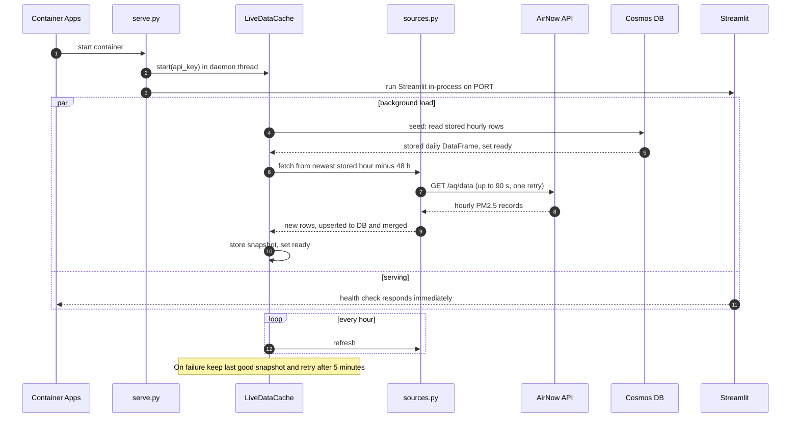

### 5.2 Page load and data-mode selection

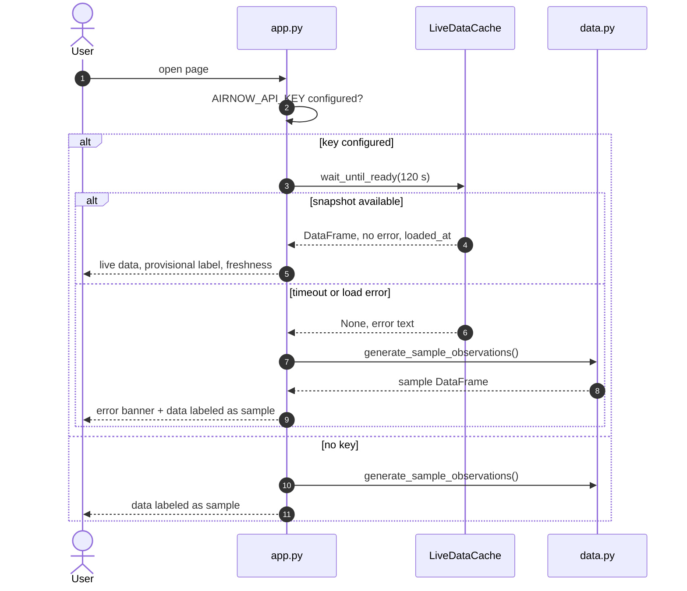

### 5.3 Grounded summary generation

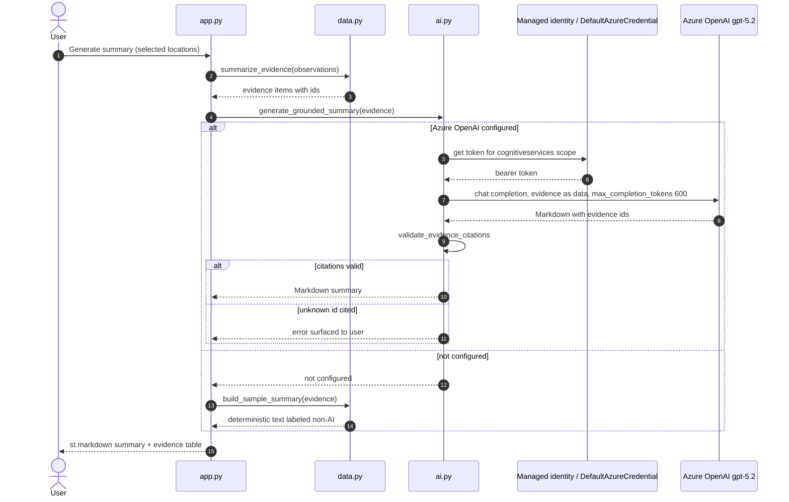

### 5.4 Data availability state

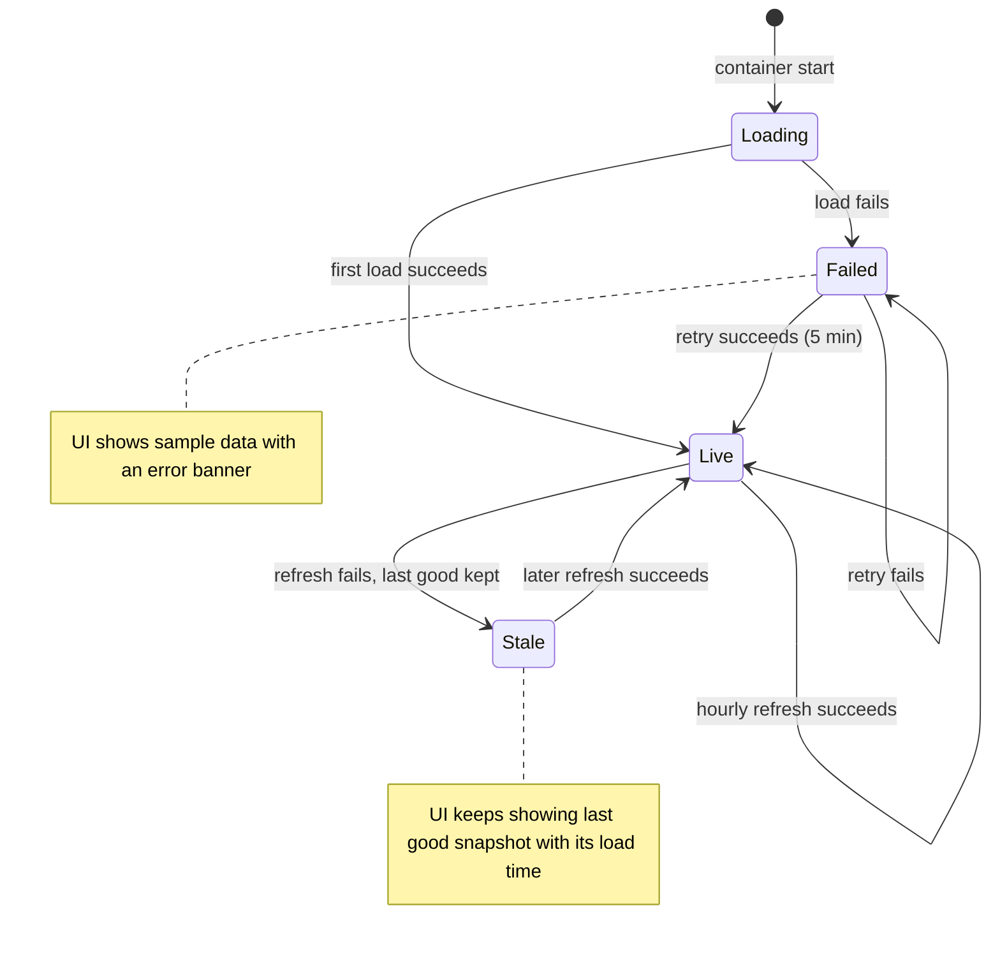

## 6. AI grounding design

| Control | Implementation | Requirement |
| --- | --- | --- |
| Constrained input | Only evidence items for the current selection are sent | FR-010 |
| Evidence as data | Prompt tells the model to treat evidence as data, not instructions | FR-010 |
| Citation | Each claim cites an evidence id; ids are validated after generation | FR-011 |
| Honest limits | Prompt requires an insufficient-evidence statement; real vs sample wording differs | FR-012 |
| Not advice | Prompt and UI state the output is not health or safety guidance | FR-013 |
| No silent fallback | A configured model failure is shown, not hidden behind the fallback | SRS 6.2 |
| Model parameters | GPT-5 family rejects `temperature`; use `max_completion_tokens=600` | design |
| Output format | Markdown with bold labels and bullets, no headings; rendered with `st.markdown` | UX |
| Evaluation | Six fixed cases checked for citations, invented numbers, advice, causal and real-time claims, headings, required wording; 18 of 18 live runs passed. The first run showed the model omitted the insufficiency statement for one observation, so the prompt now requires it for fewer than 7 observations | FR-010 to FR-012 |

## 7. Deployment design

### 7.1 Azure resources

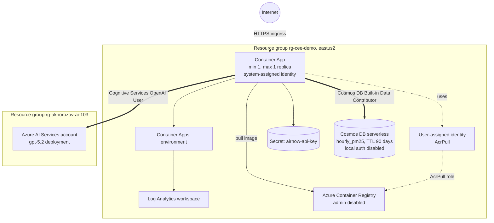

Infrastructure is defined in [infra/main.bicep](../infra/main.bicep). The
cross-resource-group role assignment lives in
[infra/openai-role.bicep](../infra/openai-role.bicep) and is created only when
the account name and resource group parameters are supplied.

### 7.2 CI/CD pipeline

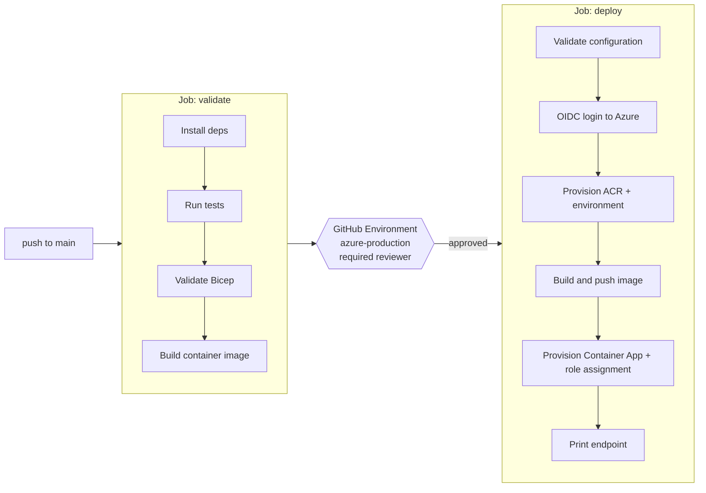

### 7.3 Deployment identity and permissions

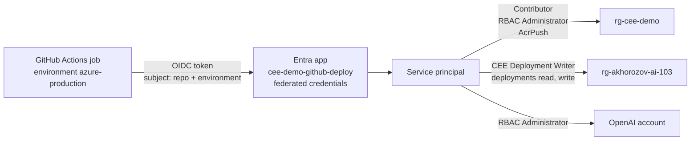

Two federated credentials exist because, after a repository rename, GitHub
issues an **ID-based** subject (`repo:owner@id/name@id:environment:...`). The
name-based credential is retained but unused.

## 8. Security design

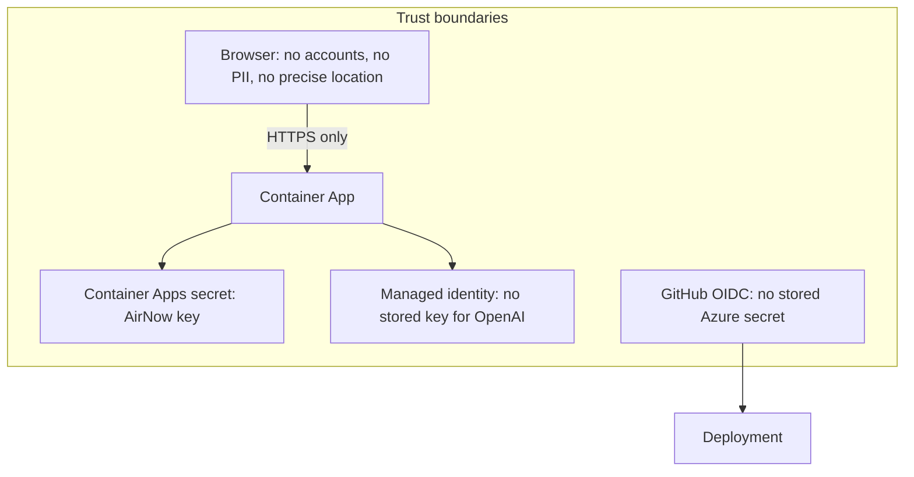

| Threat or concern | Mitigation | Requirement |
| --- | --- | --- |
| AirNow key leakage | GitHub Environment secret and Container Apps secret; never in source; error text never includes the key | NFR-006 |
| Long-lived Azure credentials | OIDC federation; managed identity at runtime | NFR-006a |
| Registry credentials | ACR admin disabled; image pull by managed identity | NFR-006b |
| Unapproved deployment | Required reviewer and `main`-only branch policy on `azure-production` | NFR-006c |
| Prompt injection via data | Evidence passed as data; citations validated | FR-010, FR-011 |
| Over-privileged deploy identity | Custom role limited to deployment read/write on the OpenAI resource group | least privilege |
| PII | No accounts, no user location, prompts not logged | NFR-004, 005, 007 |

## 9. Reliability and performance

- **Slow upstream:** AirNow takes 12 to 80 seconds; the cache decouples requests from it.
- **Warm cache:** `minReplicas=1` keeps the in-memory snapshot alive; scale-to-zero would force a 1 to 2 minute cold start.
- **Failure handling:** last good snapshot is retained; failures retry in 5 minutes; the UI falls back to labeled sample data.
- The cache is per replica, so `maxReplicas` is 1; scaling out would warm a second cache and call AirNow twice. Acceptable for a demo.

### 9.1 Observability

- **Tracing:** OpenTelemetry spans `cee.generate_summary` and `cee.load_airnow` ([cee/telemetry.py](../cee/telemetry.py)), exported to Application Insights only when `APPLICATIONINSIGHTS_CONNECTION_STRING` is set. Export setup failures are logged and never stop the app.
- **Attributes:** model deployment, token counts, finish reason, outcome, row counts. No prompts, evidence or model output are recorded; a test enforces this.
- **Dashboard:** a shared Azure Workbook ([infra/workbook.bicep](../infra/workbook.bicep)) shows calls per day, p50/p95 latency, tokens, outcomes and AirNow load time.
- **Cost:** Application Insights shares the Log Analytics workspace, so the 1 GB per day cap applies. A managed Grafana instance was deferred (DP-57) because it bills per hour.

## 10. Cost optimization

Cost figures are estimates from approximate East US 2 list prices and the
settings in `infra/main.bicep`; they are not billing data. Verify them with the
Azure pricing calculator and Cost Management.

### 10.1 Estimated monthly cost (about 730 hours)

| Item | Basis | Estimate per month |
| --- | --- | --- |
| Container App, always on | 0.5 vCPU and 1 GiB, one replica | about $30 to 40 |
| Azure Container Registry | Basic SKU | about $5 |
| Log Analytics | PerGB2018, low volume; first 5 GB per month free | $0 to 2 |
| Azure OpenAI `gpt-5.2` | About 1.5k tokens in and 600 out per summary | under $1 at demo traffic |
| AirNow, GitHub Actions, Entra | Free | $0 |
| **Total with `minReplicas=1`** | | **about $35 to 45** |

The replica dominates the cost. The figures above assume it is billed at the
"active" rate all month. Container Apps bills a replica that is mostly idle at a
lower rate, so a lightly used demo with `minReplicas=1` is more likely about
$15 to 20 per month in total. These are list-price estimates; confirm them in
Cost Management after a few days. The current production deployment sets
`minReplicas=0`.

### 10.2 Controls implemented

| Control | Implementation | Effect |
| --- | --- | --- |
| Single replica ceiling | `maxReplicas=1` | A traffic spike cannot double compute or AirNow calls |
| Configurable minimum | Environment variable `CEE_MIN_REPLICAS` passed to `minReplicas` | Set to 0 to scale to zero between demos |
| Log cap | Log Analytics `workspaceCapping.dailyQuotaGb=1` | Bounds logging cost |
| Budget alerts | `Microsoft.Consumption/budgets`, default $30 per month; emails at 50% and 100% of actual and 100% of forecast | Early warning; created only when `BUDGET_CONTACT_EMAIL` is set |
| Token cap | `max_completion_tokens=600` per summary | Bounds model cost per request |
| Managed identity | No key rotation or secret store needed | No Key Vault cost |

A budget notifies only; it does not stop spending.

### 10.3 Options and trade-offs

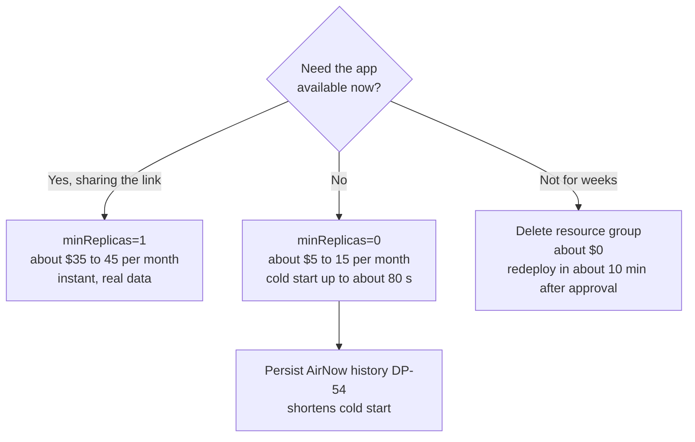

| Option | Saving | Cost of the option |
| --- | --- | --- |
| Scale to zero (`CEE_MIN_REPLICAS=0`) | Most of the compute cost | Cold start; the in-memory cache is lost on every scale-down |
| Scheduled minimum replicas | Roughly half or more | Extra automation; not implemented |
| Smaller container (0.25 vCPU, 0.5 GiB) | Roughly half of compute | Streamlit and pandas may run short of memory; not tested |
| GitHub Container Registry instead of ACR | About $5 | Pipeline changes; low value |
| Delete the resource group between pushes | Nearly all | Redeploy time and approval |
| Per-session summary rate limit | Protects model spend | Not implemented |

### 10.4 Operating guidance

1. Keep `minReplicas=1` only while the link is being shared; otherwise use 0.
2. Review Cost Management weekly while `gpt-5.2` is deployed.
3. Treat a forecast alert as a prompt to scale to zero or delete the stack.

## 11. Testing strategy

| Area | Tests |
| --- | --- |
| Sample data and evidence | [tests/test_data.py](../tests/test_data.py) |
| AI prompt, citation validation | [tests/test_ai.py](../tests/test_ai.py) |
| AirNow parsing, daily aggregation, error handling | [tests/test_sources.py](../tests/test_sources.py) |
| Cache refresh and retry behavior | [tests/test_cache.py](../tests/test_cache.py) |
| Groundedness checker (offline) | [tests/test_evaluation.py](../tests/test_evaluation.py) |
| Telemetry setup and span contents | [tests/test_telemetry.py](../tests/test_telemetry.py) |
| Groundedness of live summaries | `python -m evals.run_eval`; six cases in [evals/cases.py](../evals/cases.py), checks in [cee/evaluation.py](../cee/evaluation.py) |
| Bicep and container build | CI `validate` job |

## 12. Requirement traceability

| Requirement | Design element |
| --- | --- |
| FR-001 to FR-004 | `app.py` map, 3 km click tolerance, explicit no-data message |
| FR-005 to FR-008 | `app.py` charts and comparison from daily observations |
| FR-009 to FR-013 | `ai.py` grounding controls (section 6) |
| FR-014 to FR-016 | `sources.py`, `cache.py`, state model (5.4), labels |
| FR-017, NFR-013 | Source isolated in `sources.py`; UI consumes a DataFrame |
| NFR-006 to 006c | Section 8 |
| NFR-008, NFR-009 | Observation vs retrieval time shown; no interpolation |
| NFR-011, NFR-012 | Section 10; consumption hosting, budget, replica and token caps |
| Deployment (6.3) | Section 7 |

## 13. Design decisions

| # | Decision | Alternatives | Rationale |
| --- | --- | --- | --- |
| D1 | Streamlit single process | React + API | Fastest path; Python end to end |
| D2 | Two-level cache: in-process L1 plus Cosmos DB serverless L2 (90-day TTL, partition `/pk` = station) | Redis, Blob Storage | Redis adds a standing cost and a single replica already gives L1; Cosmos survives restarts, costs pennies, and uses managed identity (DP-54). Incremental fetch re-requests a 48 h overlap because AirNow revises data |
| D3 | AirNow `/aq/data/` | `ziplatlong` current readings | Only service giving history |
| D4 | Managed identity for OpenAI | API key | No secret to store or rotate |
| D5 | GitHub OIDC | Service principal secret | No long-lived credential |
| D6 | `minReplicas=1` by default, configurable | Scale to zero | Keeps cache warm; accepted cost, see section 10 |
| D7 | Existing AI Services account in another resource group | New account | Reuse exam resource; needs cross-RG role and custom deploy role |
| D8 | Fail loudly when a configured model errors | Silent fallback | Honesty about AI availability |

## 14. Open items

- Grafana dashboard over Application Insights (DP-57, optional).
- Run the groundedness evaluation (DP-56, implemented) in CI on a schedule.
- Budget alerts (DP-52): implemented in the Bicep; close after deployment.
- Per-session summary rate limit.
- Verifying the production deployment of the real-data release (DP-53).
